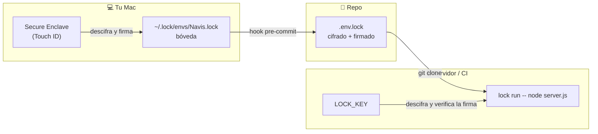

<div align="center">

# 🔐 lock

**Variables de entorno cifradas y firmadas, que se pueden comitear.**
En tu Mac se abren con Touch ID. En servidores, con una clave.
Tus agentes de IA las usan sin ver nunca su valor.


</div>

```bash
$ lock run -- npm run dev
# 👆 Touch ID: "ejecutar con Navis: npm run dev"
```

---

## ¿Por qué?

Los `.env` en texto plano tienen tres problemas:

- **No se pueden comitear.** Cada worktree, cada clon y cada servidor necesita
  que alguien le copie los secretos a mano.
- **Cualquier proceso los lee.** También el agente de IA que trabaja en tu
  repo: un `cat .env` y tus claves están en su contexto.
- **Nadie sabe si están completos.** El código usa `STRIPE_KEY`, el servidor
  no la tiene, y te enteras en producción.

`lock` los reemplaza por un `.env.lock` cifrado y firmado que viaja con el
repo. Para abrirlo hace falta una clave que nunca está en el repo: en el Mac,
dentro del Secure Enclave; en el servidor, en `LOCK_KEY`.

## ✨ Qué hace

| | |
|---|---|
| 🔑 **Touch ID en el Mac** | La clave vive en el Secure Enclave. No se puede copiar, y cada uso pide tu dedo. |
| 📦 **Comiteable** | `.env.lock` va al repo: los worktrees y los servidores lo tienen sin pasos extra. |
| ✍️ **Firmado** | Un PR no puede inyectar valores, agregar destinatarios ni volver a una versión vieja. |
| 🤖 **Apto para agentes** | `lock run` entrega los secretos al proceso, no al chat. El diálogo de Touch ID muestra el comando exacto. |
| 🪝 **Hooks de git** | pre-commit actualiza `.env.lock`; pre-push frena si el código usa variables que faltan. |
| 🖥️ **Servidores y CI** | Una sola variable, `LOCK_KEY`. Sin servicio externo, sin cuenta, sin red. |
| 🦀 **Un binario** | Rust + CryptoKit. Sin dependencias en tiempo de ejecución. |

## 🧭 Cómo funciona



- Cada entorno tiene una **clave de datos** aleatoria. Los valores se cifran con
  AES-256-GCM, ligados a su nombre: un valor no se puede mover a otra variable.
- La clave de datos se **envuelve** para cada destinatario (tu Mac, cada
  servidor, tu respaldo) con ECDH P-256 + HKDF.
- Todo el archivo va **firmado** con ECDSA P-256. Cada equipo solo acepta
  firmas de identidades en las que confía, y esa confianza nunca sale del
  propio archivo.
- Los **nombres** de las variables son públicos (se pueden listar y validar sin
  descifrar); los **valores** no.

## 🚀 Empezar

```bash
git clone https://github.com/DanielD2G/Lock && cd Lock
cargo build --release
cp target/release/lock ~/.local/bin/
```

> En macOS hacen falta las Command Line Tools de Xcode (`xcode-select --install`)
> para compilar el puente al Secure Enclave. En Linux no hace falta nada.

```bash
lock init                          # tu identidad, en el Secure Enclave
lock import Navis .env             # migra un .env existente…
rm .env                            # …y bórralo

cd ~/code/navis
lock link Navis                    # escribe .env.lock y los hooks
git add .env.lock .gitattributes && git commit -m "lock"

lock run -- npm run dev            # 👆
```

## 📖 Comandos

<details open>
<summary><b>Secretos</b></summary>

| Comando | | |
|---|---|:-:|
| `lock list` | Entornos, versiones y destinatarios | |
| `lock list Navis` | Nombres de las variables (no descifra) | |
| `lock create Navis` | Crea un entorno | 👆 |
| `lock set Navis/API_KEY` | Guarda un valor (prompt oculto o stdin) | 👆 |
| `lock set Navis/SECRET --generate 32` | Genera un valor aleatorio que nadie ve | 👆 |
| `lock get Navis/API_KEY` | Muestra un valor | 👆 |
| `lock rm Navis/API_KEY` | Borra una variable | 👆 |
| `lock import Navis .env` | Importa un `.env` | 👆 |
| `lock destroy Navis --yes` | Borra el entorno de la bóveda local | |

</details>

<details open>
<summary><b>Usar el entorno</b></summary>

| Comando | | |
|---|---|:-:|
| `lock run [ENV] -- cmd` | Ejecuta con el entorno cargado; si la salida no va a una terminal, redacta los valores | 👆 |
| `lock load [ENV]` | `eval "$(lock load)"` en tu shell | 👆 |

Dentro de un repo vinculado, el entorno se puede omitir: `lock set API_KEY`,
`lock run -- cmd`.

</details>

<details>
<summary><b>Git</b></summary>

| Comando | |
|---|---|
| `lock link Navis` | Vincula el repo: `.env.lock`, `.gitattributes` y hooks |
| `lock hooks install [--pre-commit\|--pre-push]` | Instala los hooks |
| `lock hooks uninstall` | Los quita (deja intacto el resto de tus hooks) |
| `lock hooks status` | Qué hay instalado |
| `lock dump [--stage] [--force]` | Bóveda → `.env.lock` (lo usa el pre-commit) |
| `lock pull [--force]` | `.env.lock` → bóveda, si está firmado y es más nuevo |
| `lock check` | ¿El código usa variables que no están en `.env.lock`? |
| `lock check --pre-push` | Lo mismo, sobre los commits que vas a subir |

</details>

<details>
<summary><b>Identidades y acceso</b></summary>

| Comando | | |
|---|---|:-:|
| `lock init` | Crea tu identidad | |
| `lock init --print --name prod` | Clave nueva para un servidor, CI o respaldo (no se guarda) | |
| `lock key` | Tu identidad pública `lockid1:…` | |
| `lock recipient add Navis prod lockid1:…` | Da acceso | 👆 |
| `lock recipient rm Navis prod` | Quita el acceso y rota la clave | 👆 |
| `lock recipient list [ENV]` | Quién tiene acceso | |
| `lock trust add mac2 lockid1:…` | Acepta las firmas de otra identidad tuya | |
| `lock defaults add respaldo lockid1:…` | Destinatario de todo entorno nuevo | |

</details>

## 🖥️ Servidores y CI

```bash
# En tu Mac
lock init --print --name prod          # stdout: clave privada · stderr: lockid1:…
lock recipient add Navis prod lockid1:…
git commit -am "acceso para prod" && git push

# En el servidor: guarda la clave como secreto LOCK_KEY y ejecuta
lock run -- node server.js
```

La clave impresa lleva **fijadas** tus identidades como firmantes de confianza:
el servidor rechaza cualquier `.env.lock` que no hayas firmado tú, aunque esté
cifrado a su clave. El proceso hijo recibe los secretos, nunca `LOCK_KEY`.

## 🤖 Con agentes de IA

La skill de [`skill/lock/SKILL.md`](skill/lock/SKILL.md) le enseña al agente a:

- usar `lock run` para todo lo que necesite el entorno, y avisarte antes del Touch ID;
- no leer valores nunca (`get`, `load`, `printenv`, `cat .env`);
- pedirte que escribas un secreto nuevo en el prompt oculto, nunca en el chat;
- generar con `--generate` los valores que pueden ser aleatorios.

```bash
ln -s "$PWD/skill/lock" ~/.claude/skills/lock
```

## 💾 Respaldo y otro Mac

La clave del Secure Enclave no se puede exportar: si pierdes el Mac, la pierdes.

```bash
lock init --print --name respaldo     # guarda la línea de stdout en tu gestor de contraseñas
lock defaults add respaldo lockid1:…  # destinatario de todo entorno nuevo
lock recipient add Navis respaldo lockid1:…
```

**Otro Mac:** en el nuevo, `lock init` y `lock key`. En el viejo,
`lock recipient add <ENV> mac2 lockid1:…` y `lock trust add mac2 lockid1:…`.
En el nuevo, `lock trust add mac1 lockid1:…`.

## 🛡️ Modelo de seguridad

<table>
<tr><th>✅ Protege contra</th><th>⚠️ No protege contra</th></tr>
<tr valign="top"><td>

- **Leer el repo:** los valores van cifrados.
- **Escribir en el repo:** un PR no puede falsificar valores, agregar
  destinatarios ni cambiar `@env` o `@version`.
- **Rollback:** cada equipo recuerda la versión más alta que vio y detecta dos
  versiones distintas con el mismo número.
- **Agentes curiosos:** descifrar exige Touch ID. El diálogo muestra la acción
  (`ejecutar`, `MOSTRAR`, `EXPORTAR`, `SIN REDACCION`) y el comando en una
  sola línea limpia, recortada por el medio para que el final nunca se oculte.
- **Repos hostiles:** no sigue symlinks, escribe con un temporal exclusivo +
  rename, pone límites de tamaño y sus errores nunca imprimen contenido.

</td><td>

- **Lo que tú apruebas.** Un `lock run` aprobado entrega los secretos al
  proceso hijo. La redacción de la salida evita ecos accidentales, **no es una
  barrera**: se evade con base64, un pty, `--no-redact` o escribiendo a un
  archivo. Lee el diálogo antes de apretar el dedo.
- **Claves de software en el Mac:** se usan sin Touch ID. `lock init` no las
  crea si hay Secure Enclave, y `lock key` avisa si encuentra alguna.
- **Un servidor comprometido** ve los valores de sus entornos.
- **Valores de menos de 4 caracteres:** no se redactan.
- **Servidores efímeros:** sin un `~/.lock` persistente no hay memoria contra
  rollbacks.

</td></tr>
</table>

## 🗂️ Archivos

| Ruta | |
|---|---|
| `~/.lock/envs/<Env>.lock` | Bóveda: la fuente de verdad en el Mac |
| `~/.lock/keys/*.key` | Identidades (en el Mac, blobs del Secure Enclave) |
| `~/.lock/trusted` · `recipients` · `seen` | Confianza, destinatarios por defecto, versiones vistas |
| `<repo>/.env.lock` | Copia comiteada del entorno |
| `<repo>/.lockignore` | Variables que `lock check` debe ignorar (`NOMBRE`, `PREFIJO_*`) |

**Variables:** `LOCK_KEY` · `LOCK_HOME` · `LOCK_FILE` · `LOCK_ALLOW_ROLLBACK=1` · `LOCK_NO_ENCLAVE=1`

## Formato

```text
# Cifrado con lock: no editar a mano. Los nombres son publicos; los valores no.
@lock v1
@env Navis
@version 7
@recipient daniels-mac p256-se lockpub1:BGPF… BKgv….2FLF…
@recipient prod p256 lockpub1:BHx2… BA9c….Yq0e…
DATABASE_URL=lock1:zWo8F11hw5Ts9wvl…
STRIPE_KEY=lock1:pM5ElJl5jHhZ93rh…
@signature daniels-mac lockpub1:BNa1… 9R7-AfjMJXjBZQmU…
```

Texto plano, ordenado y estable: los diffs muestran qué variables cambiaron sin
revelar sus valores.

---

<div align="center">
<sub>Hecho con 🦀 y CryptoKit</sub>
</div>
