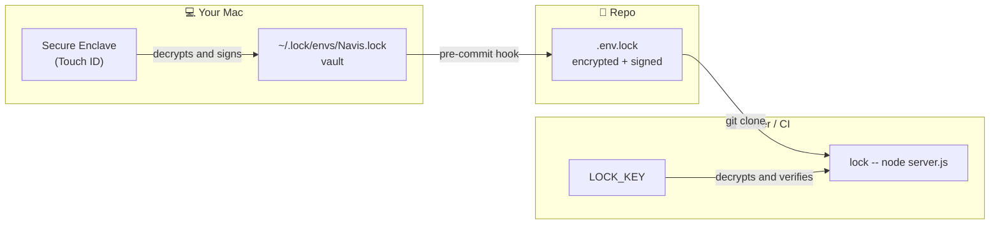

<div align="center">

# 🔐 lock

**Encrypted, signed environment variables you can commit.**
Unlock them with Touch ID on your Mac and with a key on your servers.
Your AI agents can use them without ever seeing a value.


</div>

```bash
$ lock -- npm run dev
# 👆 Touch ID: "ejecutar con Navis: npm run dev"
```

---

## Why?

Plain-text `.env` files have three problems:

- **You can't commit them.** Every worktree, clone and server needs someone
  to copy the secrets over by hand.
- **Any process can read them**, including the AI agent working in your repo.
  One `cat .env` and your keys are in its context.
- **Nobody knows if they're complete.** The code reads `STRIPE_KEY`, the
  server doesn't have it, and you find out in production.

`lock` replaces them with an encrypted, signed `.env.lock` that travels with
the repo. Opening it takes a key that is never in the repo: inside the Secure
Enclave on your Mac, in `LOCK_KEY` on your servers.

## ✨ Features

| | |
|---|---|
| 🔑 **Touch ID on your Mac** | The key lives in the Secure Enclave. It can't be copied, and every use asks for your finger. |
| 📦 **Committable** | `.env.lock` lives in the repo, so worktrees and servers get it with no extra steps. |
| ✍️ **Signed** | A pull request can't inject values, add recipients or roll back to an old version. |
| 🤖 **Agent-friendly** | `lock exec` hands secrets to the process, not to the chat. The Touch ID prompt shows the exact command. |
| 🪝 **Git hooks** | pre-commit refreshes `.env.lock`; pre-push blocks code that reads variables you haven't defined. |
| 🚀 **Servers, CI and GitHub Actions** | A single variable, `LOCK_KEY`. No external service, no account, no network. |
| 🦀 **One binary** | Rust + CryptoKit. No runtime dependencies. |

## 🧭 How it works



- Each environment has a random **data key**. Values are encrypted with
  AES-256-GCM and bound to their name, so a value can't be moved to another
  variable.
- The data key is **wrapped** for each recipient (your Mac, each server, your
  backup) with ECDH P-256 + HKDF.
- The whole file is **signed** with ECDSA P-256. Each machine only accepts
  signatures from identities it trusts, and that trust never comes from the
  file itself.
- Variable **names** are public, so you can list and validate them without
  decrypting. **Values** are not.

## 📥 Install

```bash
curl -fsSL https://raw.githubusercontent.com/DanielD2G/Lock/main/install.sh | sh
```

This installs the latest release for macOS (Apple Silicon / Intel) or Linux
(x86_64 / arm64) into `~/.local/bin` and checks its SHA-256. Run it again to
upgrade. `LOCK_VERSION=v0.1.0` pins a version; `LOCK_INSTALL_DIR` changes the
destination.

<details>
<summary>Build from source</summary>

```bash
git clone https://github.com/DanielD2G/Lock && cd Lock
cargo build --release
cp target/release/lock ~/.local/bin/
```

On macOS you need the Xcode Command Line Tools (`xcode-select --install`) to
build the Secure Enclave bridge. Nothing extra on Linux.

</details>

## 🚀 Quick start

```bash
lock init                          # your identity, in the Secure Enclave
lock import Navis .env             # migrate an existing .env…
rm .env                            # …and delete it

cd ~/code/navis
lock link Navis                    # writes .env.lock and installs the hooks
git add .env.lock .gitattributes && git commit -m "lock"

lock -- npm run dev                # 👆
```

## 📖 Commands

👆 = asks for Touch ID on a Mac.

<details open>
<summary><b>Secrets</b></summary>

| Command | | |
|---|---|:-:|
| `lock list` | Environments, versions and recipients | |
| `lock list Navis` | Variable names (no decryption) | |
| `lock create Navis` | Create an environment | 👆 |
| `lock set Navis/API_KEY` | Store a value (hidden prompt or stdin) | 👆 |
| `lock set Navis/SECRET --generate 32` | Store a random value nobody sees | 👆 |
| `lock get Navis/API_KEY` | Print a value | 👆 |
| `lock rm Navis/API_KEY` | Delete a variable | 👆 |
| `lock import Navis .env` | Import a `.env` file | 👆 |
| `lock destroy Navis --yes` | Delete the environment from the local vault | |

</details>

<details open>
<summary><b>Use the environment</b></summary>

| Command | | |
|---|---|:-:|
| `lock -- cmd` | Run `cmd` with the repo's environment loaded | 👆 |
| `lock Navis -- cmd` | Same, with an explicit environment | 👆 |
| `lock exec [ENV] -- cmd` | The long form of the two above | 👆 |
| `lock exec --no-redact -- cmd` | Don't redact the output (the Touch ID prompt says so) | 👆 |
| `lock load [ENV]` | Load into your shell: `eval "$(lock load)"` | 👆 |

When output doesn't go to a terminal (a pipe, a log, an agent), secret values
are replaced with `[lock:NAME]`. Inside a linked repo you can leave the
environment out everywhere: `lock set API_KEY`, `lock get API_KEY`.

</details>

<details>
<summary><b>Git</b></summary>

| Command | |
|---|---|
| `lock link Navis` | Link the repo: `.env.lock`, `.gitattributes` and hooks |
| `lock hooks install [--pre-commit\|--pre-push]` | Install the hooks |
| `lock hooks uninstall` | Remove them (the rest of your hooks stay intact) |
| `lock hooks status` | Show what's installed |
| `lock dump [--stage] [--force]` | Vault → `.env.lock` (used by pre-commit) |
| `lock pull [--force]` | `.env.lock` → vault, if it's signed and newer |
| `lock check` | Does the code read variables missing from `.env.lock`? |
| `lock check --pre-push` | Same, on the commits being pushed (used by pre-push) |

</details>

<details>
<summary><b>Identities and access</b></summary>

| Command | | |
|---|---|:-:|
| `lock init` | Create your identity | |
| `lock init --print --name prod` | New key for a server, CI or backup (not stored) | |
| `lock key` | Your public identity, `lockid1:…` | |
| `lock recipient add Navis prod lockid1:…` | Grant access | 👆 |
| `lock recipient rm Navis prod` | Revoke access and rotate the key | 👆 |
| `lock recipient list [ENV]` | Who has access | |
| `lock trust add mac2 lockid1:…` | Accept signatures from another of your identities | |
| `lock defaults add backup lockid1:…` | Recipient of every new environment | |

</details>

## 🖥️ Servers and CI

```bash
# On your Mac
lock init --print --name prod          # stdout: private key · stderr: lockid1:…
lock recipient add Navis prod lockid1:…
git commit -am "grant prod access" && git push

# On the server: store the key as the LOCK_KEY secret, then
lock -- node server.js
```

The printed key **pins** your identities as trusted signers: the server
rejects any `.env.lock` you didn't sign, even if it's encrypted to its key.
The child process receives the secrets, never `LOCK_KEY`.

## ⚙️ GitHub Actions

```yaml
- uses: actions/checkout@v4

# Run a command with the environment loaded (output is redacted)
- uses: DanielD2G/Lock@v0.1.0
  with:
    key: ${{ secrets.LOCK_KEY }}
    run: npm run deploy

# …or export the variables to the following steps (masked in logs)
- uses: DanielD2G/Lock@v0.1.0
  with:
    key: ${{ secrets.LOCK_KEY }}
    env: Navis
    export: true
- run: npm run deploy
```

| Input | Default | |
|---|---|---|
| `key` | (required) | Output of `lock init --print`, stored as a secret |
| `env` | repo's `.env.lock` | Environment to load |
| `run` | | Command to run with the environment loaded |
| `export` | `false` | Export variables to `$GITHUB_ENV`, masked with `::add-mask::` |
| `version` | `latest` | lock release to install |
| `working-directory` | `.` | Where the `.env.lock` lives |

Prefer `run` over `export`: with `export`, every later step (including
third-party actions) can read the secrets.

## 🤖 With AI agents

The skill in [`skill/lock/SKILL.md`](skill/lock/SKILL.md) teaches the agent to:

- use `lock exec` for anything that needs the environment, and warn you before
  the Touch ID prompt;
- never read values (`get`, `load`, `printenv`, `cat .env`);
- ask you to type new secrets into the hidden prompt, never into the chat;
- use `--generate` for values that can be random.

```bash
ln -s "$PWD/skill/lock" ~/.claude/skills/lock
```

## 💾 Backup and a second Mac

The Secure Enclave key can't be exported. If you lose the Mac, you lose the key.

```bash
lock init --print --name backup       # save stdout in your password manager
lock defaults add backup lockid1:…    # recipient of every new environment
lock recipient add Navis backup lockid1:…
```

**Second Mac:** on the new one, run `lock init` and `lock key`. On the old one,
run `lock recipient add <ENV> mac2 lockid1:…` and `lock trust add mac2 lockid1:…`.
Then, on the new one, `lock trust add mac1 lockid1:…`.

## 🛡️ Security model

<table>
<tr><th>✅ Protects against</th><th>⚠️ Does not protect against</th></tr>
<tr valign="top"><td>

- **Reading the repo:** values are encrypted.
- **Writing to the repo:** a pull request can't forge values, add recipients
  or change `@env` / `@version`.
- **Rollbacks:** each machine remembers the highest version it has seen, and
  detects two different files with the same version number.
- **Curious agents:** decrypting requires Touch ID. The prompt shows the
  action (`ejecutar`, `MOSTRAR`, `EXPORTAR`, `SIN REDACCION`) and the command
  as one clean line. Long commands are cut in the middle, so the end is never
  hidden.
- **Hostile repos:** lock never follows symlinks, writes through an exclusive
  temp file + rename, caps file sizes, and never prints file contents in errors.

</td><td>

- **What you approve.** An approved `lock exec` hands the secrets to the child
  process. Output redaction prevents accidental echoes; **it is not a
  barrier**. Base64, a pty, `--no-redact` or writing to a file all get around
  it. Read the prompt before you touch the sensor.
- **Software keys on a Mac** work without Touch ID. `lock init` refuses to
  create one when a Secure Enclave is available, and `lock key` warns if it
  finds one.
- **A compromised server** sees the values of its environments.
- **Values shorter than 4 characters** are not redacted.
- **Ephemeral servers:** without a persistent `~/.lock`, there is no rollback
  memory.

</td></tr>
</table>

## 🗂️ Files

| Path | |
|---|---|
| `~/.lock/envs/<Env>.lock` | Vault, the source of truth on your Mac |
| `~/.lock/keys/*.key` | Identities (Secure Enclave blobs on a Mac) |
| `~/.lock/trusted` · `recipients` · `seen` | Trusted signers, default recipients, versions seen |
| `<repo>/.env.lock` | Committed copy of the environment |
| `<repo>/.lockignore` | Variables `lock check` should ignore (`NAME`, `PREFIX_*`) |

**Environment variables:** `LOCK_KEY` · `LOCK_HOME` · `LOCK_FILE` · `LOCK_ALLOW_ROLLBACK=1` · `LOCK_NO_ENCLAVE=1`

## File format

```text
# Cifrado con lock: no editar a mano. Los nombres son publicos; los valores no.
@lock v1
@env Navis
@version 7
@recipient daniels-mac p256-se lockpub1:BGPF… BKgv….2FLF…
@recipient prod p256 lockpub1:BHx2… BA9c….Yq0e…
DATABASE_URL=lock1:zWo8F11hw5Ts9wvl…
STRIPE_KEY=lock1:pM5ElJl5jHhZ93rh…
@signature daniels-mac lockpub1:BNa1… 9R7-AfjMJXjBZQmU…
```

Plain text, sorted and stable: diffs show which variables changed without
revealing their values.

## 📦 Releases

Pushing a `vX.Y.Z` tag builds macOS (arm64, x86_64) and Linux (x86_64, arm64,
static musl) binaries and publishes them, with checksums, as a GitHub release.

---

<div align="center">
<sub>Built with 🦀 and CryptoKit</sub>
</div>
